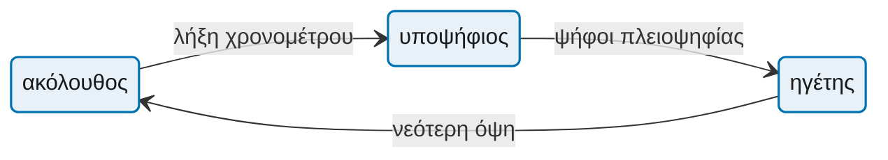
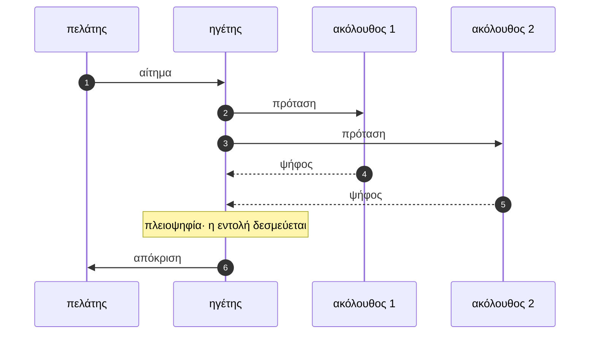
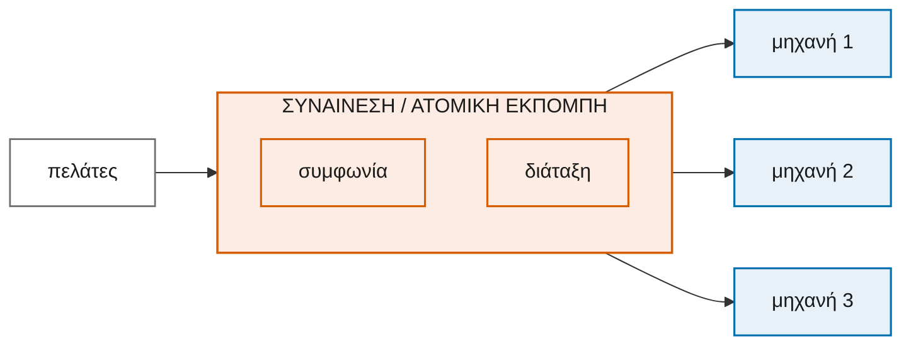

# Πρότυπα Mermaid

Και τα τρία **αποδόθηκαν και ελέγχθηκαν οπτικά** πριν μπουν εδώ.

Αντιγράφεις την επικεφαλίδα **αυτούσια** σε κάθε σχήμα. Δύο γραμμές της
δεν είναι διακοσμητικές και εξηγούνται στο `SKILL.md §4`:
`edgeLabelBackground` (αλλιώς οι ετικέτες βγαίνουν ροζ) και τα
`nodeSpacing`/`rankSpacing` (αλλιώς οι κόμβοι κολλάνε).

---

## Η επικεφαλίδα — ίδια σε κάθε σχήμα

```yaml
---
config:
  theme: base
  themeVariables:
    fontFamily: "Georgia, serif"
    fontSize: "15px"
    # --- δομή: γκρι, ποτέ χρώμα σειράς ---
    lineColor: "#6E6E6E"
    transitionColor: "#6E6E6E"
    signalColor: "#6E6E6E"
    actorLineColor: "#6E6E6E"
    # --- κείμενο: πάντα σχεδόν μαύρο ---
    transitionLabelColor: "#1A1A1A"
    stateLabelColor: "#1A1A1A"
    labelColor: "#1A1A1A"
    tertiaryTextColor: "#1A1A1A"
    signalTextColor: "#1A1A1A"
    actorTextColor: "#1A1A1A"
    noteTextColor: "#1A1A1A"
    # --- ΜΗΝ ΤΟ ΣΒΗΣΕΙΣ: χωρίς αυτό το Mermaid υπολογίζει
    #     hsl(-79.4, 100%, 93%) — αρνητική απόχρωση — και βγαίνει ροζ ---
    edgeLabelBackground: "#FFFFFF"
    tertiaryColor: "#FFFFFF"
    # --- cCFT #0072B2 : οικογένεια κατάρρευσης ---
    actorBkg: "#E8F1F8"
    actorBorder: "#0072B2"
    # --- cSand #E69F00 : σημειώσεις και επιφυλάξεις ---
    noteBkgColor: "#FDF1E3"
    noteBorderColor: "#E69F00"
    sequenceNumberColor: "#FFFFFF"
  state:
    nodeSpacing: 70
    rankSpacing: 100
  sequence:
    actorMargin: 78
    messageAlign: center
    mirrorActors: false
    wrap: false
  flowchart:
    curve: linear
    nodeSpacing: 45
    rankSpacing: 85
    padding: 12
---
```

---

## Β1 — Καταστάσεις

Ευθεία αλυσίδα, **μία** ακμή επιστροφής, **καμία** αυτο-μετάβαση.



> **Τι βγήκε, και γιατί.** Η μοιρασμένη ψήφος είναι στην πραγματικότητα
> `C --> C`. Ως αυτο-μετάβαση έσερνε τις γειτονικές ακμές έξω από το
> πλαίσιο και δημιουργούσε τρεις διασταυρώσεις. Πάει στη **λεζάντα**:
> «ο υποψήφιος που δεν συγκεντρώνει πλειοψηφία ξαναρχίζει εκλογή στην
> επόμενη όψη». Ο κανόνας Κ2 υπάρχει ακριβώς γι' αυτό.
>
> Επίσης βγήκε ο δείκτης έναρξης `[*] --> F`: πρόσθετε έναν κόμβο σε
> ξεχωριστή βαθμίδα και χαλούσε την ευθυγράμμιση της σειράς.

---

## Β2 — Ακολουθία μηνυμάτων

Το `autonumber` δεν είναι διακοσμητικό: κάνει το **πλήθος των διαδρομών
μετρήσιμο**, που είναι συνήθως ο λόγος που φτιάχνεις το σχήμα.



> `->>` συμπαγές = πρόταση· `-->>` διακεκομμένο = απόκριση. Η κατεύθυνση
> φαίνεται **και χωρίς χρώμα**, που είναι απαίτηση του κανόνα 3 της
> παλέτας.
>
> `mirrorActors: false` — χωρίς αυτό το Mermaid επαναλαμβάνει τους ρόλους
> και στο κάτω μέρος και το σχήμα διπλασιάζεται σε ύψος χωρίς λόγο.

---

## Β3 — Στοίβα / αρχιτεκτονική



> Το επίπεδο συναίνεσης είναι `cBFT`, οι μηχανές `cCFT`, οι πελάτες
> λευκοί με γκρι περίγραμμα. Ο χρωματισμός λέει **ποιο επίπεδο κάνει τη
> δύσκολη δουλειά**, δεν διακοσμεί.
>
> Το `direction TB` μέσα σε `subgraph` **αγνοείται** όταν υπάρχουν ακμές
> που περνούν το όριο. Μη στηρίζεσαι σε αυτό (κανόνας Κ1).

---

## Πώς το βλέπεις

```bash
bash scripts/render-mermaid.sh figures/katastaseis.mmd
```

Το GitHub και οι οδηγοί μελέτης το αποδίδουν μόνοι τους — αρκεί το μπλοκ
να είναι σε ```` ```mermaid ````.
